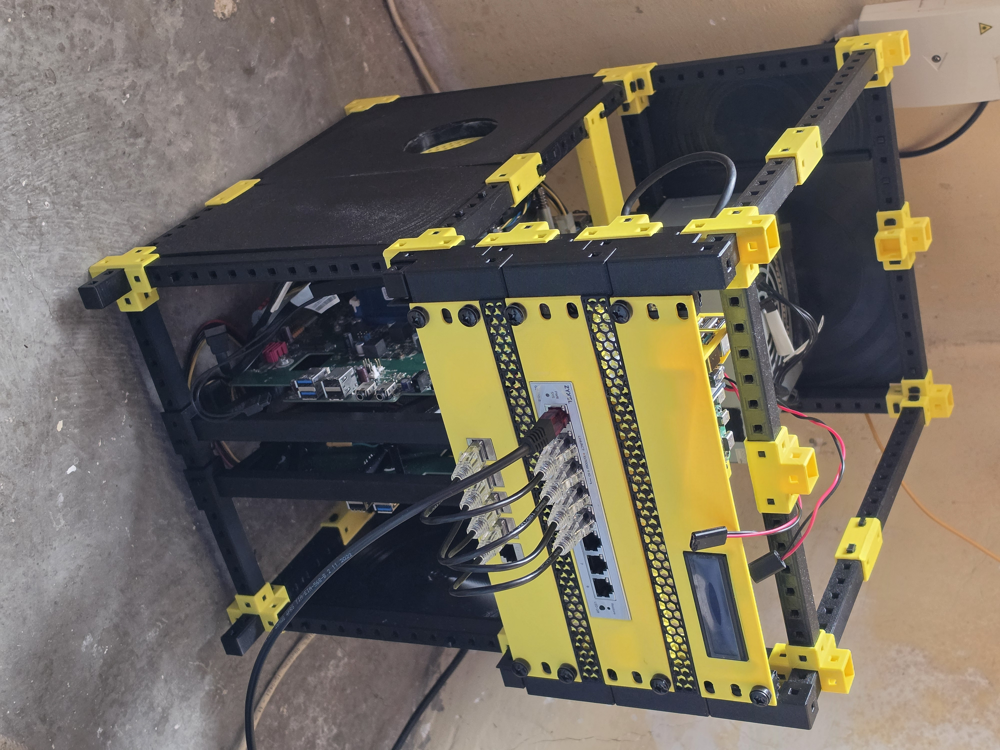

# ⚡ Yggdrasil Modular Homelab

## 🧭 Introducción y Motivación del Proyecto

Durante mi etapa de formación en ciberseguridad, detecté la necesidad de consolidar y profundizar en los fundamentos de **redes y sistemas** antes de seguir avanzando. Con el objetivo de demostrar experiencia práctica y un entendimiento real de la infraestructura, decidí diseñar y construir este homelab desde cero.

A falta de presupuesto para adquirir servidores comerciales, opté por aprovechar una impresora 3D que tenía en casa y reutilizar componentes de hardware (placas base de equipos Lenovo V530s y una fuente de alimentación ATX de 500W). Tomando inspiración de estructuras modulares de [kellerlabs/homeracker](https://github.com/kellerlabs/homeracker), he adaptado y diseñado mis propias soluciones en función de mis necesidades.

Este repositorio documenta todo el proceso. Al igual que el árbol mitológico que le da nombre, el núcleo de red de este homelab actúa como **Yggdrasil**: el eje central encargado de interconectar todos los nodos y dispositivos del sistema.

---

## 📸 Estado Actual del Montaje

_(Esta imagen se irá actualizando a medida que avance el ensamblaje físico del chasis, el cableado de la fuente y la finalización de la tapas)._

---

## 🛠️ Arquitectura y Hardware Utilizado

- **Chasis:** Estructura modular personalizada e impresa en 3D.
- **Nodos de Cómputo:** 2x Placas base de ordenadores Lenovo V530s reutilizadas.
- **Cerebro de Red / Control:** 1x Raspberry Pi 4 + 1x Raspberry Pi Pico (para control térmico).
- **Networking:** Switch gestionable Zyxel + Panel de conexiones con Keystones.
- **Monitorización:** Pantalla LCD integrada y control térmico por hardware.
- **Alimentación:** Fuente de alimentación ATX de 500W adaptada al sistema.

---

## 🧭 ¿Qué encontrarás en este repositorio?

1. **[Arquitectura y Topología](./docs/architecture.md):** Decisiones de hardware, distribución eléctrica de la fuente (raíles de 12V y 5V) y esquema de red.
2. **[Diario de Troubleshooting](./docs/troubleshooting.md):** Registro detallado de problemas de montaje, retos de hardware y retos actualmente abiertos.
3. **[Configs](./configs/):** Scripts de automatización, control térmico en MicroPython y configuraciones de red.
