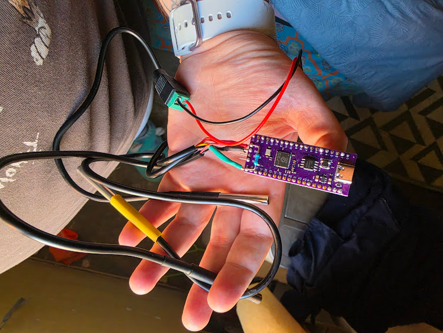

# 🏛️ Arquitectura del Chasis y Distribución Física

Este documento detalla la distribución de los componentes dentro de la estructura modular del homelab.

---

## 🏗️ 1. Planta Superior

- **Exterior (Frontal de 1U):**
  - Alberga los tres paneles principales: el panel del switch, el panel de keystones y un panel compartido que integra la Raspberry Pi (ésta de carácter interno) y la pantalla LCD.
  - **Trasera:** Incorpora un módulo keystone dedicado para sacar el cable Ethernet principal hacia el exterior por la parte posterior, manteniendo el frontal completamente limpio y libre de cables colgando
  - **Cubierta Superior:** Incorpora el panel superior cerrado con un **ventilador de extracción de 120 mm** instalado para la evacuación del calor generado por el sistema. 
  - *Estado actual:* Chasis parcialmente abierto/en pausa de cierre hermético. Aprovechando la temporada de invierno (donde la gestión térmica es menos crítica), se prioriza avanzar en las capas de software y control técnico antes de sellar definitivamente el recinto.
- **Interior:**
  - Aloja la fuente de alimentación ATX.
  - _Para ver los retos de integración y el cambio de orientación de la Raspberry Pi con el SSD NVMe, consulta el [Diario de Troubleshooting](../docs/troubleshooting.md#issue-raspberry-pi)._

---

## 🧱 2. Planta Inferior

- **Interior:**
  - Destinada exclusivamente a albergar las dos placas base de los Lenovo colocadas en **posición vertical** (presindiendo de sus carcasas originales para optimizar el espacio).
  - _Para ver las decisiones de diseño sobre el chasis a medida, el flujo de aire contrapuesto y la solución de las tapas laterales con embudos térmicos, consulta los siguientes apartados del [Diario de Troubleshooting](../docs/troubleshooting.md#issue-chasis-inferior):_
    - _[Diseño del chasis inferior y sujeción estructural](../docs/troubleshooting.md#issue-chasis-inferior)_
    - _[Rediseño y reimpresión de las tapas laterales con embudos térmicos](../docs/troubleshooting.md#issue-tapas-laterales)_

---

## ⚡ 3. Distribución Eléctrica y Raíles

La fuente ATX suministra energía adaptada a las necesidades específicas de cada componente mediante una organización estructurada del cableado:

- **Línea de +12V:**
  - Alimentación principal para las placas base de los Lenovo ubicadas en la planta inferior (utilizando bifurcadores comerciales para duplicar los conectores de alimentación de forma segura)
  - Suministro de +12V para los ventiladores PWM del sistema, tomados desde una rama auxiliar mediante un **adaptador Molex de 4 pines a SATA modificado** (de este modo se evita intervenir en los ramales principales de las placas Lenovo).
- **Línea de +5V:**
  - Destinada a alimentar de forma estable la Raspberry Pi 4 y el switch Zyxel, evitando la necesidad de adaptadores de corriente externos adicionales.
  - Alimentación autónoma de la **Raspberry Pi Pico** (pin `VBUS`) extraída desde el hilo de +5V del mismo arnés Molex-SATA modificado, compartiendo masa común (`GND`) con los ventiladores para garantizar la referencia de la señal PWM.
  _Para ver el detalle de la modificación del arnés Molex-SATA, el encadenado de alimentación de los ventiladores y las decisiones electrónicas del bus 1-Wire, consulta el [Issue #10 en el Diario de Troubleshooting](../docs/troubleshooting.md#issue-molex-sata)._

---

## 🌡️ 4. Control Térmico y Sensores (Raspberry Pi Pico)

La gestión de temperatura se centraliza en una **Raspberry Pi Pico** ejecutando MicroPython, fijada provisionalmente en uno de los paneles laterales interiores de la planta superior (junto a la fuente ATX) y alimentada de forma autónoma por los +5V (`VSYS`) del arnés Molex-SATA.

- **Bus de Sensores 1-Wire (`GPIO 19`):** Tres sondas **DS18B20** conectadas en paralelo con una resistencia *pull-up* externa de 4.7 kΩ hacia `3V3`:
  - **Sensor `004b`:** Interior de la fuente de alimentación ATX.
  - **Sensor `00dd`:** Zona térmica del Nodo Lenovo A.
  - **Sensor `0043`:** Zona térmica del Nodo Lenovo B.
- **Canales PWM Independientes (25 kHz):**
  - **`GPIO 10`:** Regula el ventilador silencioso sustituido en la fuente ATX (con un suelo mínimo de seguridad del 30 %).
  - **`GPIO 12`:** Regula la ventilación de los nodos Lenovo tomando la lectura máxima entre los sensores `00dd` y `0043`.
 

  > 💻 **Código fuente:** Puedes revisar el script completo en MicroPython con las curvas térmicas y el *fail-safe* en [`configs/picoTemperatura.py`](../configs/picoTemperatura.py).

 

   
  <em>Montaje de pruebas de los sensores y la Raspberry Pico</em>

