 # 📝 Diario de Ingeniería y Resolución de Incidencias

## 🟢[Issue #01] Alojamiento interno del SSD NVMe y reorientación de la Raspberry Pi 4

- **Contexto del problema:** Para evitar la corrupción de datos típica de las tarjetas MicroSD debido a las escrituras constantes, se valoró inicialmente un SSD HAT, pero la compatibilidad física y la escasez de opciones adaptadas al diseño compacto complicaron la elección.
- **Solución adoptada:** Se optó por reutilizar un disco NVMe en una carcasa externa. Dado que el almacenamiento debía quedar completamente integrado dentro del chasis, se decidió rotar físicamente la Raspberry Pi para facilitar el conexionado de los cables de manera interna.
- **Registro fotográfico:**
  - **Antes (Disposición inicial sin SSD interno):**
    

      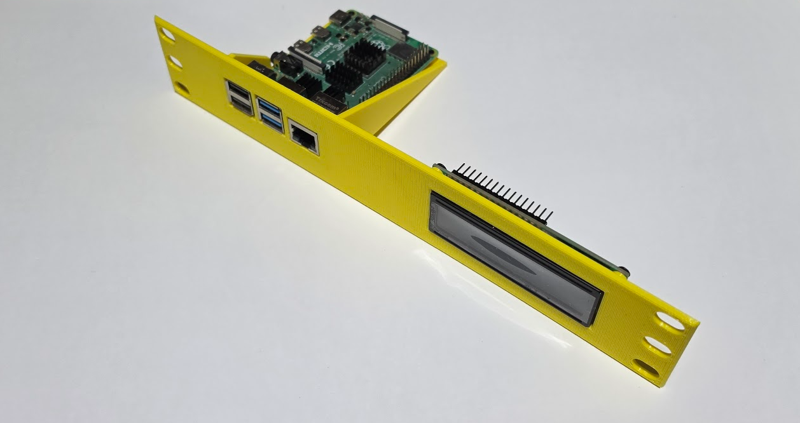
    
  
  - **Después (Raspberry reorientada con el NVMe integrado):**
    

      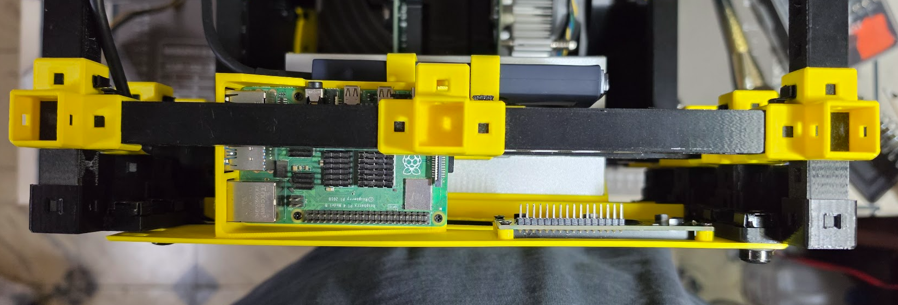
    

---

## 🟢[Issue #02] Diseño del chasis a medida para las placas base en la planta inferior

- **Contexto del problema:** Alojar las dos placas base de los Lenovo en la parte inferior supuso un reto de diseño importante debido a su volumen original. Se descartó conservar las carcasas de fábrica por su tamaño excesivo, optando por fabricar un chasis modular a medida.
- **Proceso de deliberación y diseño térmico:** Tras valorar distintas opciones sobre el flujo de aire, se optó por una disposición contrapuesta con los ventiladores orientados hacia el exterior. Esta decisión motivó posteriormente el diseño de las tapas laterales con forma de embudo y rejilla para expulsar el aire caliente directamente fuera del sistema.
- **Reto estructural adicional:** Inicialmente se planteó un semi-chasis donde las placas colgasen únicamente de un lateral; sin embargo, por motivos de robustez y seguridad estructural, se rediseñó el soporte para sujetarlas firmemente de ambos lados.
- **Registro fotográfico:**

  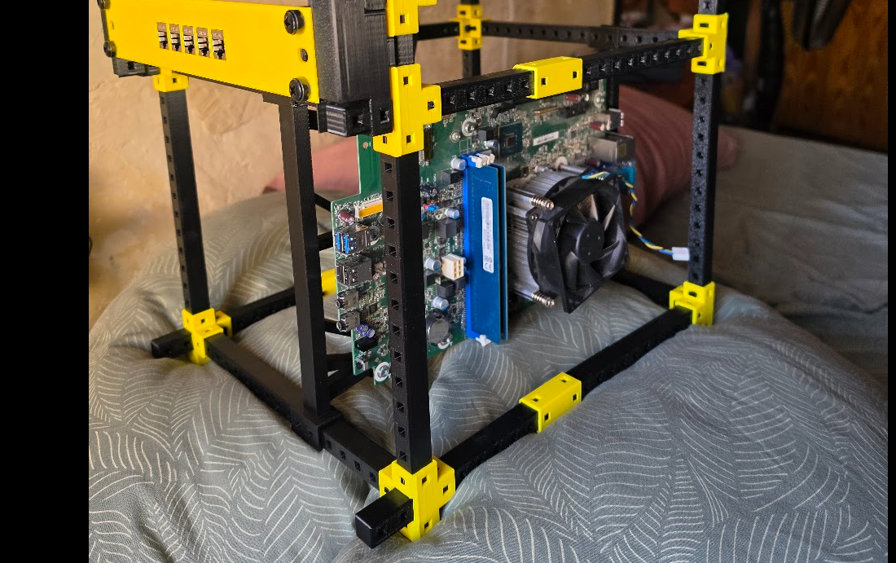
  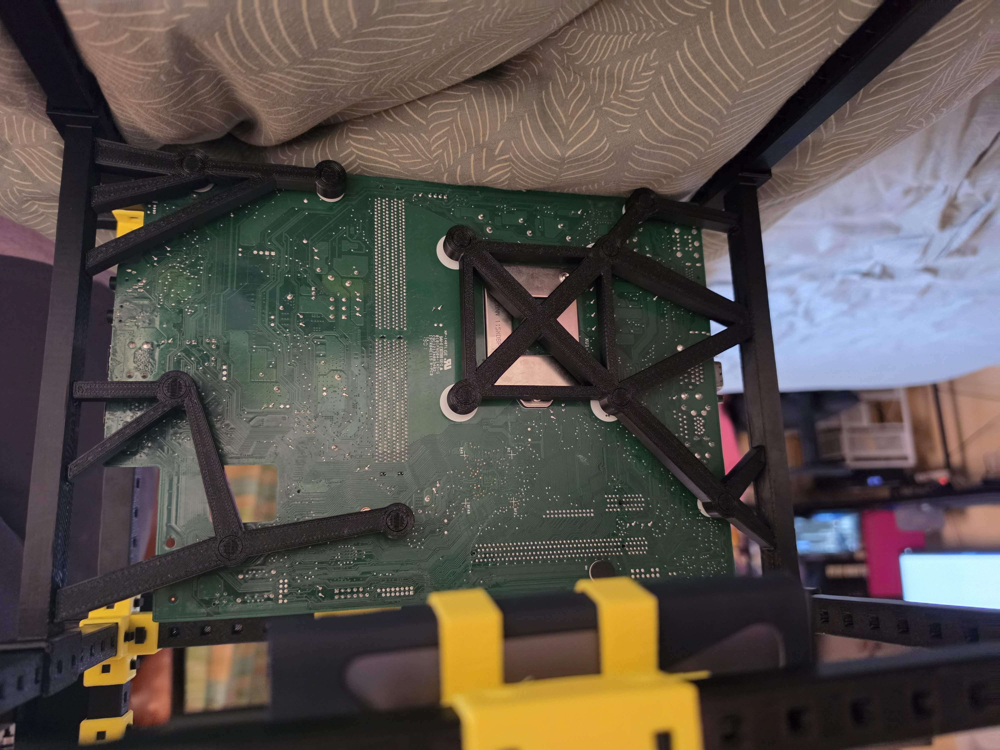

---

## 🟢[Issue #03] Espacios tolerantes y diseño de parches modulares para el frontal superior

- **Contexto del problema:** Al desconocer las dimensiones exactas de las unidades de 1U y tener dificultades para visualizar el conjunto final, se optó por imprimir la cara frontal del piso superior por partes. Esto generó un espacio intermedio inútil entre los paneles de 1U que requirió una solución sin necesidad de rehacer las piezas principales.
- **Proceso de diseño de las rejillas:** Se diseñó un parche modular en forma de rejillas que encajaban perfectamente en el hueco sobrante. El proceso requirió varias iteraciones:
  - El objetivo inicial era crear un conjunto de dos rejillas hexagonales superpuestas (con una rejilla interior amarilla donde la arista de los hexágonos coincidiera con el centro de los hexágonos exteriores negros).
  - Tras descartar el cambio de filamento a mitad de impresión por complejidad, se optó por imprimir ambas piezas por separado y unirlas posteriormente.
- **Registro fotográfico:**
  - **Antes (Espacio inútil entre paneles tras el primer montaje por partes):**
  

    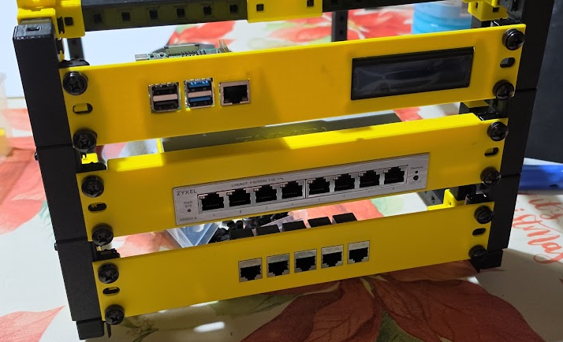
  
  

  - **Después (Parche de rejillas hexagonales impresas por separado y ensambladas):**
   

     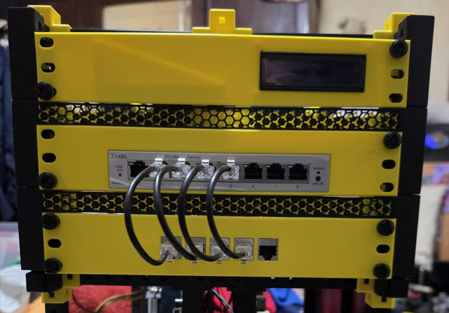
    

---

## 🟢[Issue #04] Rediseño y reimpresión de las tapas laterales inferiores con embudos térmicos

- **Contexto del problema:** Las tapas laterales destinadas a cubrir la parte baja del chasis requerían unos embudos específicos para canalizar y expulsar directamente el flujo de aire de los disipadores de las CPU hacia el exterior.
- **Retos y fallos de la primera versión:**
  - La unión mecánica inicial entre las dos partes de las tapas no ofreció la rigidez ni el ajuste esperado, haciendo que fallara el ensamblaje.
  - Además, al intentar imprimir las piezas de una sola vez, la rejilla situada en el agujero de salida del aire era estructuralmente demasiado débil, por lo que terminó partiéndose.
- **Solución aplicada:**
  - Se modificó por completo el diseño de las uniones en Onshape para corregir las tolerancias.
  - Se rediseñó el sistema dividiendo la pieza: se imprimieron los dos embudos y una rejilla amarilla interior **por separado**, acoplándolos posteriormente a las tapas originales a las que previamente se les había retirado la rejilla rota.
  - Finalmente, se procedió a la reimpresión completa de las tapas con el nuevo diseño optimizado.
- **Registro fotográfico:**
  - **Antes (Versión inicial con uniones defectuosas y rejilla frágil):**
    

      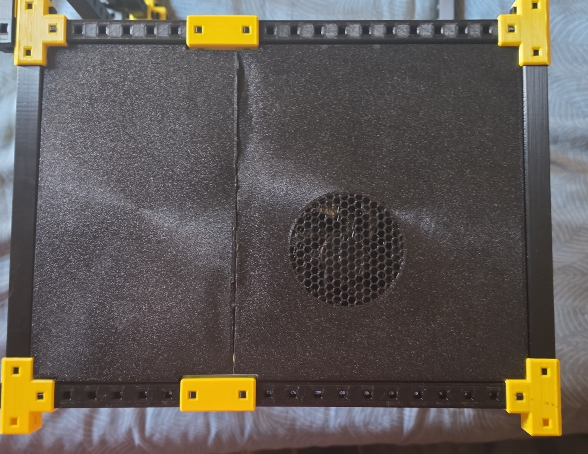
   

  - **Después (Tapas reimpresas con embudos independientes y ensamblaje mejorado):**
    

      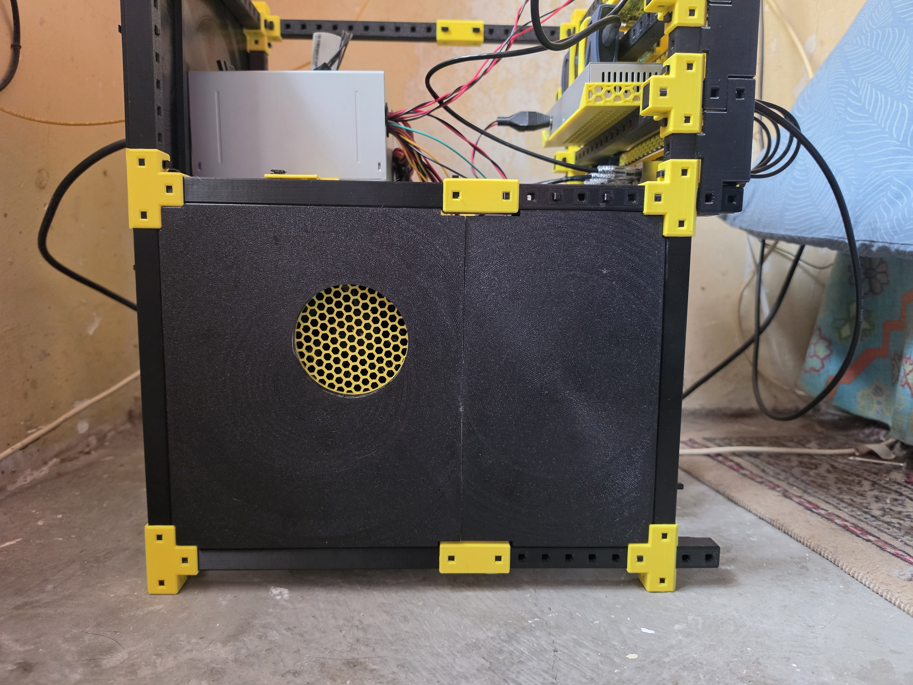
    

## 🟡 [Issue #05] Planificación futura: Integración de discos duros en formato Hotswap

- **Contexto de la mejora:** Uno de los objetivos a medio plazo es incorporar dos discos duros para configurar un sistema de almacenamiento en red (NAS) o un entorno de pruebas RAID dentro del chasis modular.
- **Decisión de diseño:** Aunque montarlos de forma interna sería más sencillo, se ha descartado una instalación fija. El requisito indispensable es que sean discos **intercambiables en caliente (hotswap)** debido a mis propias preferencias.
- **Referencia técnica seleccionada:** Para resolver el soporte mecánico 3D sin necesidad de piezas metálicas complejas o costosas, se utilizará un diseño de la comunidad que es 100% imprimible y se necesita exclusivamente un muelle:
  - **Enlace de referencia (MakerWorld):** [Soporte para disco duro Daier (呆鹅) / Servidor / Caja NAS](https://makerworld.com/zh/models/633465#profileId-558661)
- **Estado actual:** 🟡 **Pendiente de implementación física** (a la espera de avanzar con las siguientes fases del ensamblaje del chasis).

## 🟢[Issue #06] Cubierta para el hueco generado por la montura estándar de rack

- **Contexto del problema:** Debido a que me atraía la idea de que el frontal pareciese un rack 100%, decidí imprimir la opción que da KellerLab para poder poner unidades de rack. Todo esto genera un hueco en la parte superior en la que se ve el interior y puede conllevar que entre polvo.

- **Proceso de deliberación y diseño:** El primer paso en este tipo de piezas es generar un ensamblaje (*assembly*) con las piezas utilizadas y mapear la cubierta a medida:

  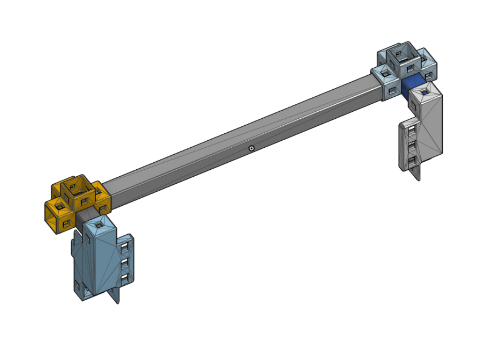

- **Registro fotográfico:**

  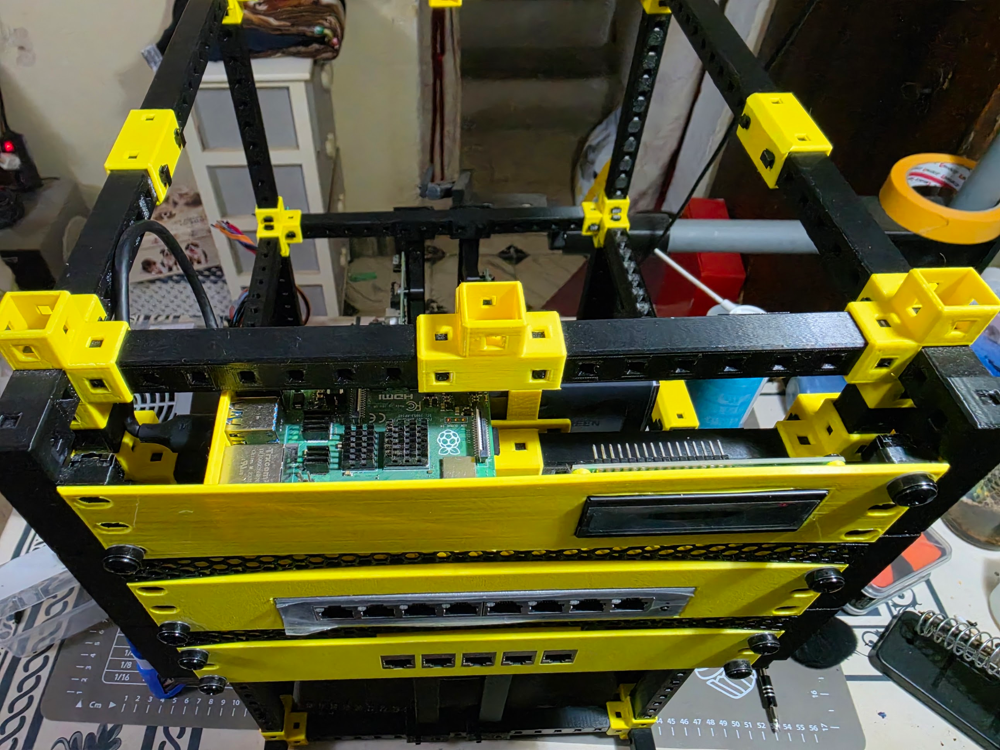
  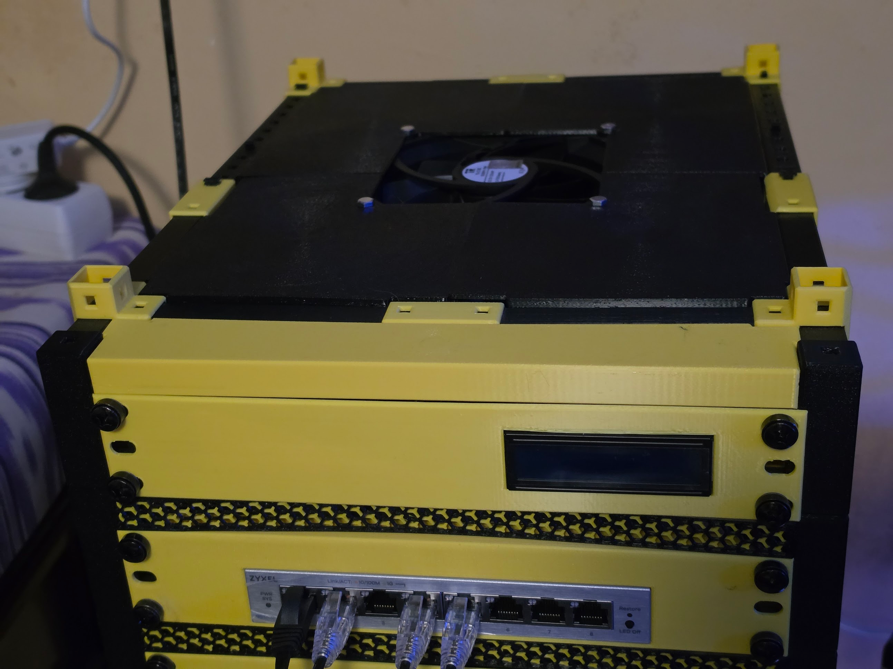

---

## 🟢[Issue #07] Rediseño de la tapa trasera para añadir keystone y despejar el frontal

- **Contexto del problema:** El nuevo diagrama de red llevó a replantear la distribución de los keystones y del switch Zyxel, buscando sacar el enlace principal por la parte posterior para evitar exceso de cables cruzando por el frontal.
- **Solución aplicada:** Aprovechando que la tapa trasera de la fuente de alimentación estaba dividida en dos piezas, se rediseñó una de las mitades en Onshape para integrar el alojamiento exacto de un módulo keystone adicional, quedando instalado y operativo.
- **Registro fotográfico:**

  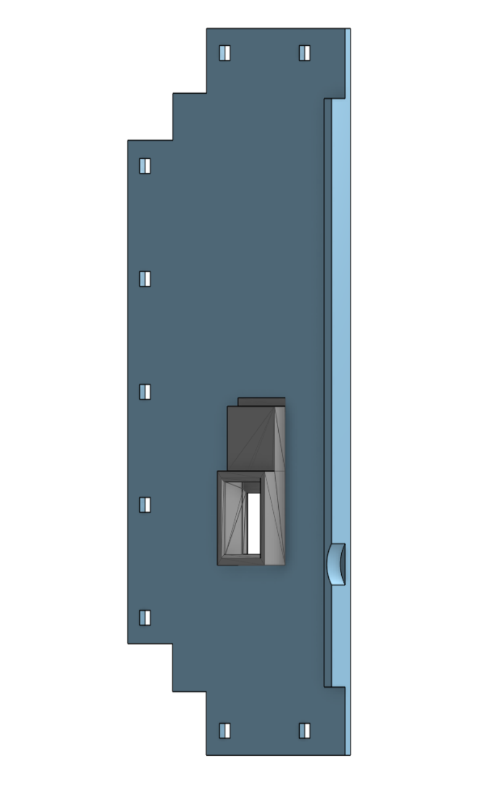
  

---

## 🟢[Issue #08] Ruido constante de la fuente ATX reciclada y sustitución del ventilador (*Fan Swap*)

- **Contexto del problema:** Al reutilizar una fuente de alimentación ATX de 500W procedente de un equipo de sobremesa antiguo, su ventilador interno giraba de forma continua al 100 % de revoluciones por falta de control térmico integrado, generando un nivel de ruido excesivo.
- **Proceso de diagnóstico y solución:**
  - Se sustituyó el ventilador original de 2 pines por un modelo silencioso PWM de 4 pines, extrayendo su cable de control PWM (`Pin 4`) hacia el exterior de la fuente para gobernarlo desde la Raspberry Pi Pico (`GPIO 10`) con un suelo mínimo de seguridad del 30 %.

---

## 🟢[Issue #09] Arnés auxiliar Molex-SATA e integración del control térmico autónomo (Raspberry Pi Pico)

- **Contexto del problema:** Era necesario alimentar los ventiladores de 12V y la Raspberry Pi Pico (5V) sin cortar ni intervenir en los ramales principales dedicados a las placas base Lenovo.
- **Proceso de diseño y solución:**
  - **Arnés desmontable:** Se modificó un adaptador comercial Molex de 4 pines a SATA retirando el conector SATA y soldando un arnés independiente con funda termorretráctil (+12V para ventiladores, +5V hacia el pin `VSYS` de la Pico y masa común `GND`).
  - **Simplificación electrónica:** Al emplear ventiladores PWM de 4 pines (25 kHz) y alimentación compartida en cadena (*daisy-chain*) con canales PWM separados (`GPIO 10` para la fuente y `GPIO 12` para los nodos), se descartó el uso de transistores MOSFET externos.
  - **Bus de sensores:** Se integraron 3 sondas digitales **DS18B20** en paralelo sobre el bus 1-Wire (`GPIO 19`) con una resistencia *pull-up* externa de 4.7 kΩ hacia `3V3`.