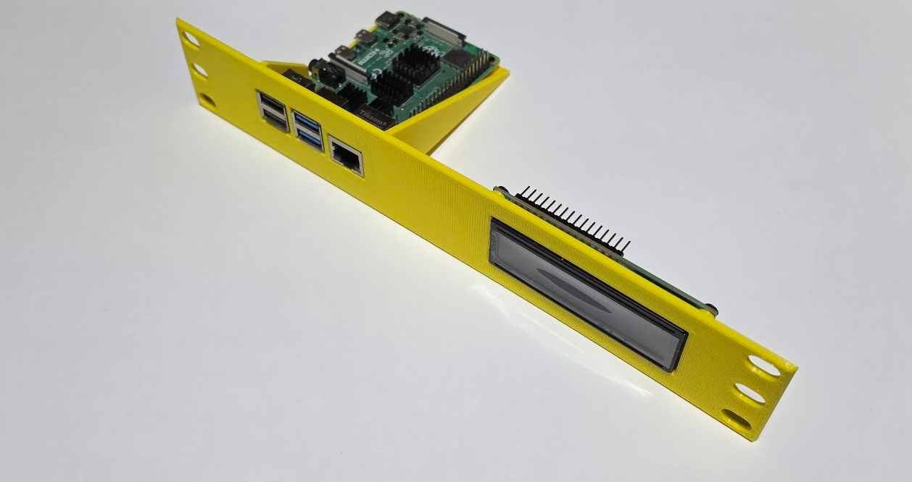
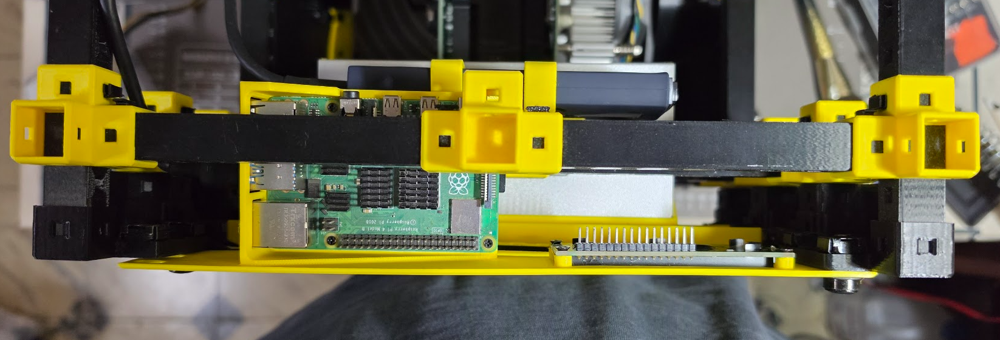
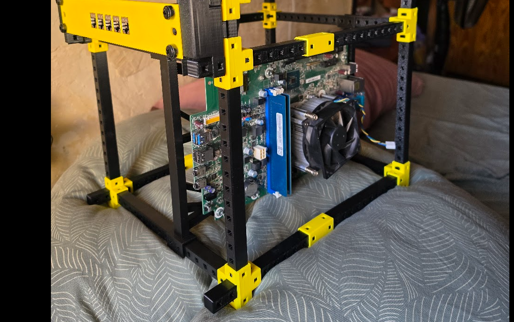
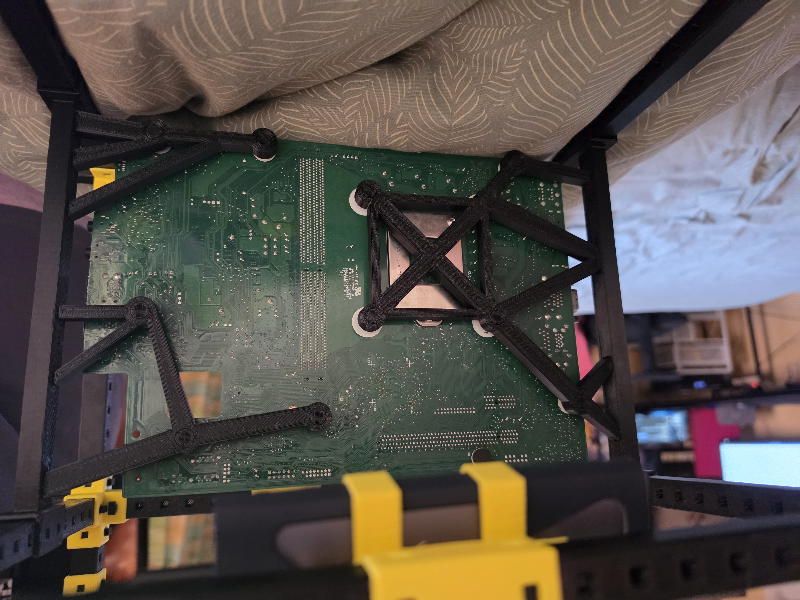
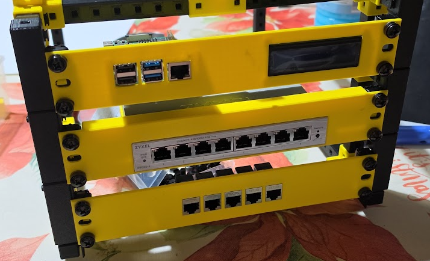
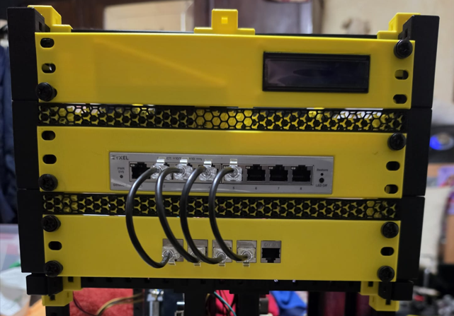
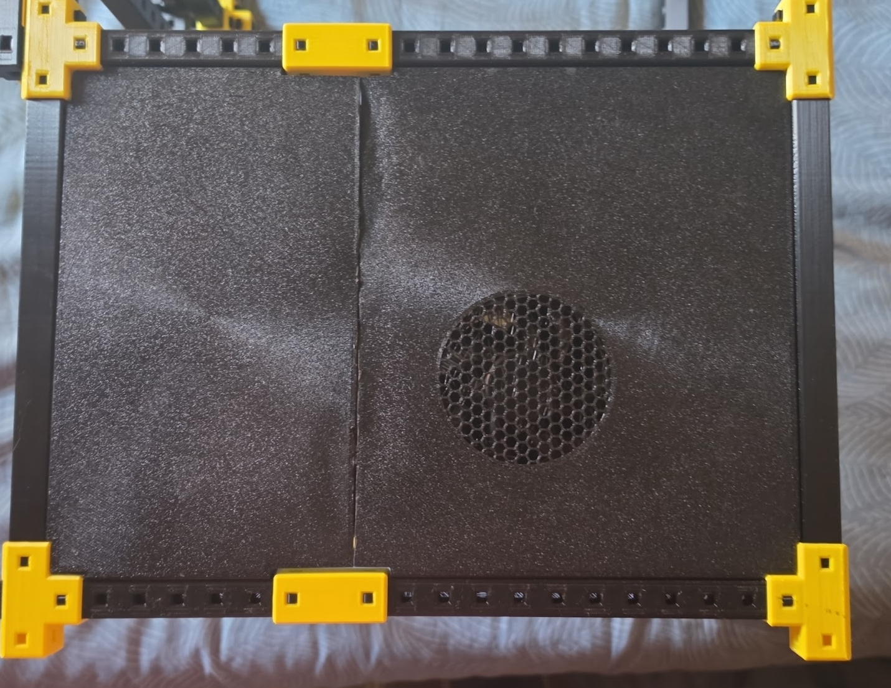
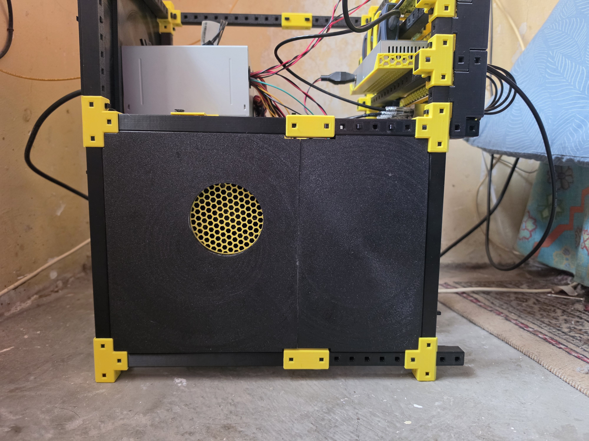

# 📝 Diario de Ingeniería y Resolución de Incidencias

## [Issue #01] Alojamiento interno del SSD NVMe y reorientación de la Raspberry Pi 4

- **Contexto del problema:** Para evitar la corrupción de datos típica de las tarjetas MicroSD debido a las escrituras constantes, se valoró inicialmente un SSD HAT, pero la compatibilidad física y la escasez de opciones adaptadas al diseño compacto complicaron la elección.
- **Solución adoptada:** Se optó por reutilizar un disco NVMe en una carcasa externa. Dado que el almacenamiento debía quedar completamente integrado dentro del chasis, se decidió rotar físicamente la Raspberry Pi para facilitar el conexionado de los cables de manera interna.
- **Registro fotográfico:**
  - **Antes (Disposición inicial sin SSD interno):**
    
  - **Después (Raspberry reorientada con el NVMe integrado):**
    

---

## [Issue #02] Diseño del chasis a medida para las placas base en la planta inferior

- **Contexto del problema:** Alojar las dos placas base de los Lenovo en la parte inferior supuso un reto de diseño importante debido a su volumen original. Se descartó conservar las carcasas de fábrica por su tamaño excesivo, optando por fabricar un chasis modular a medida.
- **Proceso de deliberación y diseño térmico:** Tras valorar distintas opciones sobre el flujo de aire, se optó por una disposición contrapuesta con los ventiladores orientados hacia el exterior. Esta decisión motivó posteriormente el diseño de las tapas laterales con forma de embudo y rejilla para expulsar el aire caliente directamente fuera del sistema.
- **Reto estructural adicional:** Inicialmente se planteó un semi-chasis donde las placas colgasen únicamente de un lateral; sin embargo, por motivos de robustez y seguridad estructural, se rediseñó el soporte para sujetarlas firmemente de ambos lados.
- **Registro fotográfico:**

  
  

---

## [Issue #03] Espacios tolerantes y diseño de parches modulares para el frontal superior

- **Contexto del problema:** Al desconocer las dimensiones exactas de las unidades de 1U y tener dificultades para visualizar el conjunto final, se optó por imprimir la cara frontal del piso superior por partes. Esto generó un espacio intermedio inútil entre los paneles de 1U que requirió una solución sin necesidad de rehacer las piezas principales.
- **Proceso de diseño de las rejillas:** Se diseñó un parche modular en forma de rejillas que encajaban perfectamente en el hueco sobrante. El proceso requirió varias iteraciones:
  - El objetivo inicial era crear un conjunto de dos rejillas hexagonales superpuestas (con una rejilla interior amarilla donde la arista de los hexágonos coincidiera con el centro de los hexágonos exteriores negros).
  - Tras descartar el cambio de filamento a mitad de impresión por complejidad, se optó por imprimir ambas piezas por separado y unirlas posteriormente.
- **Registro fotográfico:**
  - **Antes (Espacio inútil entre paneles tras el primer montaje por partes):**
    
  - **Después (Parche de rejillas hexagonales impresas por separado y ensambladas):**
    

---

## [Issue #04] Rediseño y reimpresión de las tapas laterales inferiores con embudos térmicos

- **Contexto del problema:** Las tapas laterales destinadas a cubrir la parte baja del chasis requerían unos embudos específicos para canalizar y expulsar directamente el flujo de aire de los disipadores de las CPU hacia el exterior.
- **Retos y fallos de la primera versión:**
  - La unión mecánica inicial entre las dos partes de las tapas no ofreció la rigidez ni el ajuste esperado, haciendo que fallara el ensamblaje.
  - Además, al intentar imprimir las piezas de una sola vez, la rejilla situada en el agujero de salida del aire era estructuralmente demasiado débil, por lo que terminó partiéndose.
- **Solución aplicada:**
  - Se modificó por completo el diseño de las uniones en Onshape para corregir las tolerancias.
  - Se rediseñó el sistema dividiendo la pieza: se imprimieron los dos embudos y una rejilla amarilla interior **por separado**, acoplándolos posteriormente a las tapas originales a las que previamente se les había retirado la rejilla rota.
  - Finalmente, se procedió a la reimpresión completa de las tapas con el nuevo diseño optimizado.
- **Registro fotográfico:**
  - **Antes (Versión inicial con uniones defectuosas y rejilla frágil):**
    
  - **Después (Tapas reimpresas con embudos independientes y ensamblaje mejorado):**
    
